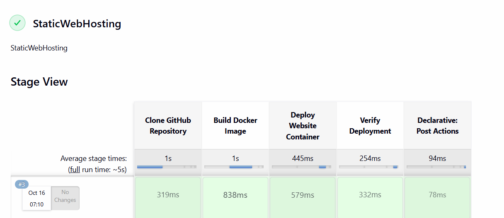
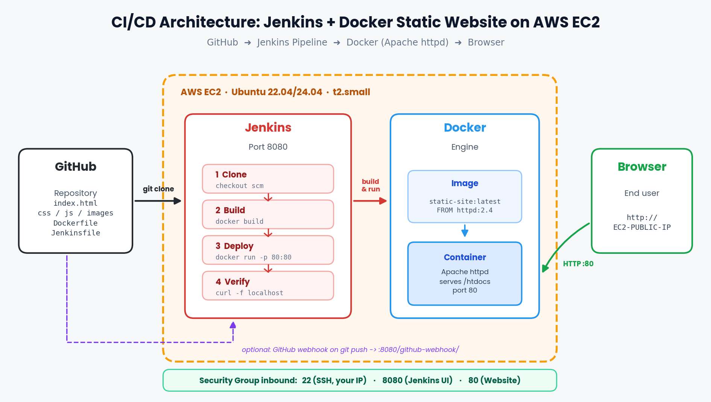
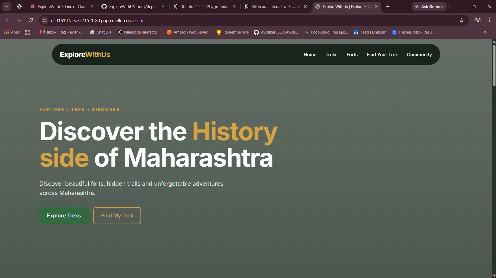
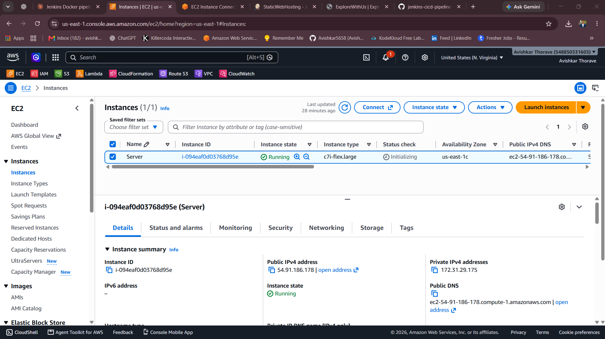
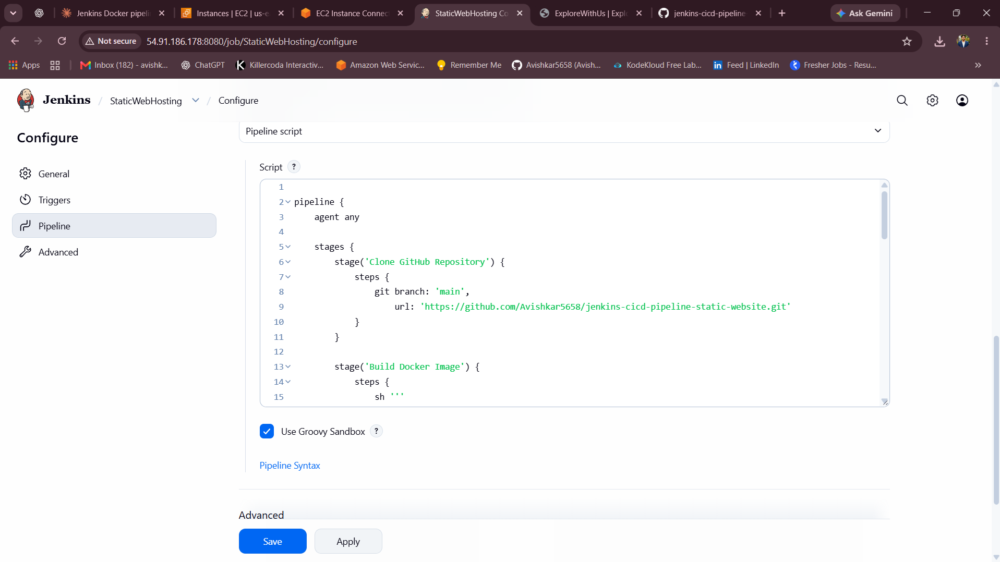
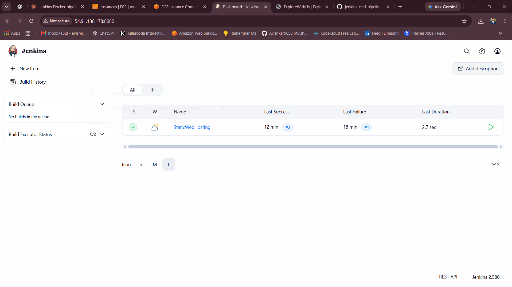
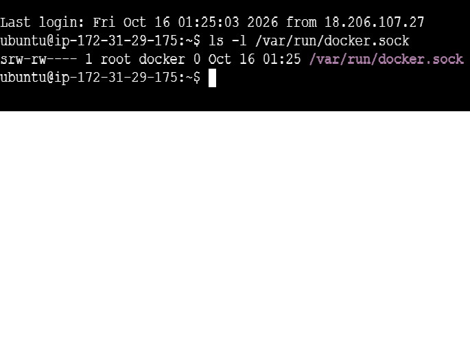

<div align="center">

# 🚀 Jenkins CI/CD Pipeline: Host a Static Website with Docker on AWS

### Push your website to GitHub → Jenkins builds it → Docker serves it. **One click, no manual work.**


<br>



<sub>👆 <b>The pipeline in action:</b> each column is one step (clone, build, deploy, verify). Green means it worked.</sub>

</div>

---

## 📑 Table of Contents

1. [The Problem](#-the-problem-in-plain-english)
2. [The Solution](#-the-solution)
3. [Architecture](#-architecture)
4. [Tools Used and Why](#-tools-used-and-why)
5. [How the Pipeline Works](#-how-the-pipeline-works)
6. [Demo and Screenshots](#-demo-and-screenshots)
7. [Step-by-Step Implementation](#-step-by-step-implementation)
8. [When Something Breaks](#-when-something-breaks)
9. [Challenges and What I Learned](#-challenges-and-what-i-learned)
10. [Cost Note and Cleanup](#-cost-note-and-cleanup)
11. [Future Improvements](#-future-improvements)
12. [Use This Project](#-use-this-project-in-your-own-repo)

---

## 🤔 The Problem 

Imagine you built a website and you want people to see it online. Every time you change something (a new photo, a new page, a fix), you have to:

1. Log in to the server 🖥️
2. Copy the new files across 📂
3. Rebuild the website 🔧
4. Restart it 🔄
5. Hope you didn't forget a step 🤞

- 😟 It is **slow** and boring, and you repeat it for every small change
- 😟 It is **easy to make mistakes** (wrong file, forgotten step)
- 😟 If you are away, **nobody else** knows how to do it

Real companies update their websites many times a day. They can't do all this by hand.

## 💡 The Solution

This project shows **how it's automated**, using a practice called **CI/CD** with a tool called **Jenkins**.

> 🥪 **Sandwich shop analogy**
>
> Think of a sandwich shop with a **very careful assistant**.
>
> - 📖 **GitHub** is the **recipe book**: it stores the latest recipe (your website code).
> - 🧑‍🍳 **Jenkins** is the **assistant**: you press one button and it follows a checklist, step by step.
> - 🍱 **Docker** is the **lunchbox**: your website is packed in a sealed box that works the same way on any table.
> - 🧪 **Verify** is the **taste test**: the assistant checks that the sandwich is really good before serving.
>
> You change the recipe. You press the button. The customers get the fresh sandwich. Nobody has to do the work by hand.

| Term | Simple meaning |
|------|----------------|
| 🐙 **GitHub** | A website where your code is stored safely |
| 🤖 **Jenkins** | A free robot assistant that runs your checklist automatically |
| 🔁 **CI/CD** | *Continuous Integration / Continuous Delivery*: automatically build, check and release every change |
| 📋 **Pipeline** | The checklist Jenkins follows, written as a small script |
| 🪜 **Stage** | One step of the checklist (for example "Build") |
| 🐳 **Docker** | Packs your website in a "box" (called a *container*) that runs the same everywhere |
| 🖥️ **EC2** | A computer you rent from Amazon (AWS) to run everything |

### ✅ Result

**One click turns your GitHub code into a live website**, with every step visible and checked.

---

## 🏗️ Architecture

<div align="center">
  
</div>

**How to read the diagram (follow the arrows):**

1. 🐙 Your website code lives in a **GitHub repository**.
2. 🤖 **Jenkins** (port `8080`) clones the code from GitHub.
3. 🧱 Jenkins asks **Docker** to build an **image** (the sealed box with your website inside).
4. ▶️ Docker starts a **container** from that image. An **Apache** web server inside it serves the pages.
5. 🧪 Jenkins checks that the website really answers.
6. 🌐 A **visitor** opens `http://<EC2-PUBLIC-IP>:8000` in the browser and sees the site.

Everything runs on **one EC2 server**. The dashed purple line shows an optional upgrade: a *webhook* that starts the pipeline automatically on every `git push`.

---

## 🧰 Tools Used and Why

| Tool | What it is (simple) | Why it's used here |
|------|---------------------|--------------------|
| **GitHub** | Online storage for code | Keeps the website source and the pipeline script |
| **Amazon EC2** (Ubuntu) | A rented computer in the cloud | Runs Jenkins and the website |
| **Jenkins** | An automation server | Runs the checklist (the pipeline) on demand |
| **Pipeline: Stage View** (plugin) | A table showing each step of every run | Lets you see at a glance which step worked or failed |
| **Docker** | Packs apps into containers | Makes the website run the same way everywhere |
| **Apache HTTP Server** (`httpd`) | A web server | Serves the website pages inside the container |
| **Security Group** | A virtual firewall | Opens only the ports needed: `22`, `8080`, `8000` |
| **Git** | Version control | Lets Jenkins download the code |

---

## ⚙️ How the Pipeline Works

Every time you press **Build Now**, Jenkins runs these **four stages** in order. If a stage fails, the run stops and shows red.

| Stage | What Jenkins does | In plain words |
|:-----:|-------------------|----------------|
| **1. Clone GitHub Repository** 📥 | Downloads the `main` branch | "Get the latest recipe" |
| **2. Build Docker Image** 🧱 | Packs the website into an image | "Put the website in a sealed box" |
| **3. Deploy Website Container** 🚀 | Removes the old container and starts a new one on port `8000` | "Put the fresh box on the shelf" |
| **4. Verify Deployment** 🧪 | Checks the container is running and the site answers | "Taste test before serving" |
| **Post Actions** 🏁 | Prints a success or failure message | "Report back" |

---

## 📸 Demo and Screenshots

### 🌐 The final result: a live website

The site below is served by a Docker container that Jenkins built and started.

<div align="center">
  
</div>

### 📊 Jenkins Stage View: from red to green

Build **#1** failed because Jenkins was not yet allowed to use Docker (fixed in Step 6). Builds **#2** and **#3** passed on every stage.

<div align="center">
  
</div>

### 🖥️ The server and the pipeline setup

<table>
  <tr>
    <td align="center" width="50%"><b>☁️ EC2 server is running</b><br><sub>The computer that hosts everything</sub></td>
    <td align="center" width="50%"><b>📝 Pipeline script in Jenkins</b><br><sub>The checklist, written as code</sub></td>
  </tr>
  <tr>
    <td></td>
    <td></td>
  </tr>
</table>

### ✅ Jenkins is up, and it can use Docker

<table>
  <tr>
    <td align="center" width="50%"><b>Jenkins service is active</b></td>
    <td align="center" width="50%"><b>Jenkins can run Docker commands</b></td>
  </tr>
  <tr>
    <td></td>
    <td></td>
  </tr>
</table>

---

## 🛠️ Step-by-Step Implementation

> 🌎 **Region used:** US East (N. Virginia), `us-east-1`

### ✅ Prerequisites

- An [AWS account](https://aws.amazon.com/free/)
- A **GitHub repository** with your static website files and a `Dockerfile` (see Step 1)
- Basic ability to use the AWS Console and copy-paste commands

---

### Step 1️⃣ — Prepare your GitHub repository

Your repository needs your website files and a tiny `Dockerfile`:

```dockerfile
FROM httpd:2.4
COPY ./ /usr/local/apache2/htdocs/
```

This says: *"Start from the Apache web server and copy my website into it."*

---

### Step 2️⃣ — Launch the EC2 server

- **Service:** EC2 → Launch instance
- **Name:** `Server`
- **AMI:** Ubuntu (22.04 or 24.04)
- **Instance size:** at least **2 GB of memory** (Jenkins feels slow on very small machines)
- **Security group, allow inbound:**

| Port | Used for | Allow from |
|------|----------|-----------|
| `22` | SSH (logging in) | Your IP |
| `8080` | Jenkins web page | Your IP (recommended) |
| `8000` | The website | Anywhere (`0.0.0.0/0`) |

> 🔒 **Hardening tip:** the Jenkins page controls your server. Allow port `8080` **only from your own IP address**, not from the whole internet.

Then open the instance → **Connect** → **EC2 Instance Connect** → **Connect**. A terminal opens in your browser.

<div align="center">
  
</div>

---

### Step 3️⃣ — Install Java, Git, Docker and Jenkins

Run these blocks one at a time.

**3.1 Install the basics** (Jenkins needs Java; the pipeline needs Git and Docker):

```bash
sudo apt update
sudo apt install -y fontconfig openjdk-21-jre git docker.io curl
java -version
```

**3.2 Add the Jenkins repository** (the 2026 signing key):

```bash
sudo wget -O /etc/apt/keyrings/jenkins-keyring.asc \
  https://pkg.jenkins.io/debian-stable/jenkins.io-2026.key

echo "deb [signed-by=/etc/apt/keyrings/jenkins-keyring.asc] https://pkg.jenkins.io/debian-stable binary/" \
  | sudo tee /etc/apt/sources.list.d/jenkins.list > /dev/null
```

**3.3 Install Jenkins and start everything:**

```bash
sudo apt update
sudo apt install -y jenkins
sudo systemctl enable --now docker
sudo systemctl enable --now jenkins
sudo systemctl status jenkins
```

✅ Look for a green **active (running)**:

<div align="center">
  
</div>

---

### Step 4️⃣ — Unlock Jenkins

1. Get the first-time password:
   ```bash
   sudo cat /var/lib/jenkins/secrets/initialAdminPassword
   ```
2. Open `http://<EC2-PUBLIC-IP>:8080` in your browser and paste the password.
3. Click **Install suggested plugins** (this includes the **Stage View** plugin).
4. Create your admin user.

> 🔐 Never share or screenshot this password.

---

### Step 5️⃣ — (Skip if already installed) Check the Stage View plugin

Stage View draws the green and red table you saw at the top. If you don't see it on your job page: **Manage Jenkins → Plugins → Available plugins**, search **`Pipeline: Stage View`**, and install it.

---

### Step 6️⃣ — Give Jenkins permission to use Docker

> ⚠️ **The most important step.** Without it, the Build stage fails (this is exactly what happened in build #1).

```bash
sudo usermod -aG docker jenkins
sudo systemctl restart jenkins
sudo -u jenkins docker ps
```

If the last command prints a table header and **no error**, Jenkins can use Docker ✅

<div align="center">
  
</div>

---

### Step 7️⃣ — Create the pipeline job

1. Jenkins home → **New Item**
2. Name: `StaticWebHosting`, choose **Pipeline**, click **OK**
3. Under **Pipeline**, set **Definition** to **Pipeline script**
4. Paste the script below, tick **Use Groovy Sandbox**, then **Save**

```groovy
pipeline {
    agent any

    stages {
        stage('Clone GitHub Repository') {
            steps {
                git branch: 'main',
                    url: 'https://github.com/<YOUR-USERNAME>/<YOUR-REPO>.git'
            }
        }

        stage('Build Docker Image') {
            steps {
                sh 'docker build -t static-website:latest .'
            }
        }

        stage('Deploy Website Container') {
            steps {
                sh '''
                docker rm -f static-website || true
                docker run -d --name static-website -p 8000:80 static-website:latest
                '''
            }
        }

        stage('Verify Deployment') {
            steps {
                sh '''
                sleep 3
                docker ps | grep static-website
                curl -f http://localhost:8000
                '''
            }
        }
    }

    post {
        success { echo 'Website deployed successfully' }
        failure { echo 'Pipeline failed, check the console output' }
    }
}
```

> 💡 `-p 8000:80` means: *"visitors knock on port 8000 of the server, and Docker passes them to port 80 inside the box."* Port `8080` stays free for Jenkins.

<div align="center">
  
</div>

---

### Step 8️⃣ — Run it and open your website 🎉

1. On the job page, click **Build Now**
2. Watch the **Stage View**: all stages should turn **green**
3. Open `http://<EC2-PUBLIC-IP>:8000` in your browser
4. *(Optional)* On the server, check the container: `docker ps`

---

### ⌨️ Bonus: Build automatically on every `git push`

1. GitHub repository → **Settings → Webhooks → Add webhook**
2. Payload URL: `http://<EC2-PUBLIC-IP>:8080/github-webhook/`, content type `application/json`
3. In the Jenkins job: **Triggers → GitHub hook trigger for GITScm polling**

Now a `git push` starts the pipeline by itself.

---

## 🛟 When Something Breaks

Jenkins shows you **which step** failed. Click the red cell, then **Console Output**, to read the reason.

| What you see | Likely reason | Fix |
|--------------|---------------|-----|
| Build, Deploy and Verify turn **red** on the first run | Jenkins is not allowed to use Docker | Do Step 6, then **Build Now** again |
| `permission denied ... docker.sock` in the log | Same as above | Add `jenkins` to the `docker` group and restart Jenkins |
| Website opens on the server but not in your browser | Port `8000` is closed in the firewall | Add an inbound rule for `8000` in the Security Group |
| Jenkins page doesn't open | Port `8080` is closed, or Jenkins is stopped | Add inbound `8080`; run `sudo systemctl status jenkins` |
| `port is already allocated` | An old container still uses the port | The Deploy stage already runs `docker rm -f`; rebuild |
| Site address stopped working after a restart | The server got a **new public IP** | Use the new IP, or attach an **Elastic IP** |
| Website changes don't appear | The old image is still running | Click **Build Now** again to rebuild from the latest code |

---

## 🎓 Challenges and What I Learned

> ✏️ *Replace or extend the rows below with problems you actually faced. Genuine lessons stand out the most.*

| Challenge | How I solved it |
|-----------|-----------------|
| First build **failed** at Build, Deploy and Verify | Gave the `jenkins` user permission to run Docker, restarted Jenkins, and the next builds passed |
| Jenkins and the website both wanted a port | Kept Jenkins on `8080` and mapped the website to `8000` (`-p 8000:80`) |
| Needed to know *which* step broke | Used the Jenkins **Stage View** to spot the failing stage instantly |

**Key takeaways**

- ✅ What **CI/CD** is and why teams use it
- ✅ How a **Jenkins pipeline** is built from stages
- ✅ How **Docker** packages a website so it runs the same everywhere
- ✅ How to read the **Stage View** and fix a failed build
- ✅ How ports, firewalls and permissions work together on a cloud server

---

## 💰 Cost Note and Cleanup

This project uses a billable AWS server. Check current prices on the [EC2 pricing page](https://aws.amazon.com/ec2/pricing/). A server that is left running keeps costing money, even when nobody visits the site.

### 🧹 Clean up when you finish (to avoid charges)

1. On the server, stop the website: `docker rm -f static-website`
2. In the EC2 console, **Terminate** the instance
3. Delete the **Security Group** you created for it
4. If you added an **Elastic IP**, release it

> ⚠️ Always check the AWS Billing dashboard after cleanup.

---

## 🔮 Future Improvements

- [ ] 🔔 Add the **GitHub webhook** so every `git push` deploys automatically
- [ ] 📄 Move the pipeline into a **`Jenkinsfile`** in the repo (*Pipeline script from SCM*)
- [ ] 📌 Attach an **Elastic IP** so the address never changes
- [ ] 🔐 Add **HTTPS** with a domain name and a free certificate
- [ ] 🌐 Serve the site on port **80** behind a reverse proxy
- [ ] 📬 Send a **Slack or email** message when a build fails
- [ ] 🏗️ Create the server automatically with **Terraform**

---

## 🔁 Use This Project in Your Own Repo

Want to try it or add it to your own portfolio?

1. **Fork** this repository (top-right button) or download it as a ZIP
2. Replace the website files with **your own** (keep the `Dockerfile` in the same folder)
3. In the Jenkins pipeline, change the repository link to **your repo's URL**
4. Follow the [step-by-step guide](#-step-by-step-implementation) in your own AWS account
5. Replace the images in `screenshots/` with **your own**
6. Write your own **Challenges and What I Learned** section
7. ⭐ If it helped you, give the repo a star!

### 📁 Repository structure

```
jenkins-cicd-pipeline-static-website/
├── README.md
├── index.html            # your website (plus css / js / images)
├── Dockerfile            # packs the website into a Docker image
├── Jenkinsfile           # the same pipeline, saved as a file
└── screenshots/
    ├── architecture.png
    ├── ec2-instance.png
    ├── jenkins-running.png
    ├── docker-permission.png
    ├── pipeline-config.png
    ├── stage-view.png
    └── website-live.png
```

---

## 👤 Author

**Avishkar Thorave**

[](https://github.com/Avishkar5658)
[](https://www.linkedin.com/in/avishkar-thorve-a77a8b2a1)

---

<div align="center">

⭐ **If you found this useful, give it a star!** ⭐

*Built with ☁️ AWS, 🤖 Jenkins, 🐳 Docker and a lot of curiosity.*

</div>
